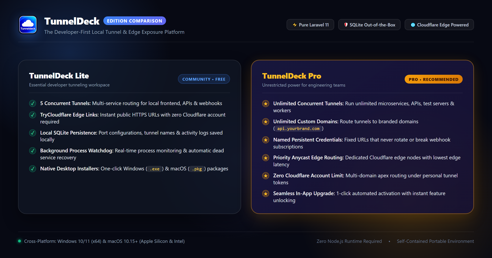

# TunnelDeck Lite

<div align="center">



<br><br>

[](https://github.com/code-salsa/tunneldeck-lite/releases/latest)
[](#-downloads--official-releases)
[](#requirements)
[](#)
[](#)

A modern, lightweight developer tunnel management platform built as a **pure Laravel application** with **native Blade views, vanilla HTML, CSS, and native JavaScript AJAX** — zero Node.js runtime required!

[**📥 Download Latest Release**](https://github.com/code-salsa/tunneldeck-lite/releases/latest) • [**🪟 Windows Setup**](#-windows-installation) • [**🍎 macOS Setup**](#-macos-installation) • [**🚀 Quick Start**](#-quick-start-workspace-mode)

</div>

---

## 📥 Downloads & Official Releases

Official standalone installers for **Windows** and **macOS** are published under [**Releases v1.0.0**](https://github.com/code-salsa/tunneldeck-lite/releases/tag/v1.0.0).

| Platform | Package Format | Architecture | File Size | Download Link |
|:---|:---|:---|:---|:---|
| **Windows 10 / 11** | Standalone Setup Wizard (`.exe`) | x64 | **24.65 MB** | [**Download Tunneldeck.exe**](https://github.com/code-salsa/tunneldeck-lite/releases/download/v1.0.0/Tunneldeck.exe) |
| **macOS 10.15+** | Native Flat Package (`.pkg`) | Apple Silicon (M1/M2/M3/M4) & Intel | **8.12 MB** | [**Download Tunneldeck.pkg**](https://github.com/code-salsa/tunneldeck-lite/releases/download/v1.0.0/Tunneldeck.pkg) |

### 🔐 SHA-256 Checksums

Verify package authenticity using SHA-256:

| Package | SHA-256 Checksum |
|:---|:---|
| `Tunneldeck.exe` | `9008FCF4E20A8A70D8A627B7874A26A6D1743722D5D3429AE2EC0BCCA4970C47` |
| `Tunneldeck.pkg` | `CF4E5ACFE4B4201BC8CEEF7015D04319FBB26B1EA29075FB6FA0BCF8C7359AF6` |

To verify on Windows (PowerShell):
```powershell
Get-FileHash -Path .\Tunneldeck.exe -Algorithm SHA256
```

To verify on macOS (Terminal):
```bash
shasum -a 256 Tunneldeck.pkg
```

---

## 🪟 Windows Installation

The Windows installer is a **single, standalone setup wizard** (`Tunneldeck.exe`) that delivers a native setup experience with zero external dependencies.

### Installation Steps:
1. Download [**`Tunneldeck.exe`**](https://github.com/code-salsa/tunneldeck-lite/releases/download/v1.0.0/Tunneldeck.exe).
2. Double-click **`Tunneldeck.exe`** to launch the Setup Wizard.
3. Follow the wizard steps:
   - **Welcome Screen:** Overview of TunnelDeck Lite.
   - **Destination Location:** Select target folder (defaults to `%LOCALAPPDATA%\Programs\TunnelDeck Lite`, requiring **no administrator / UAC privileges**).
   - **Shortcuts & Preferences:** Choose whether to create a Desktop shortcut and Start Menu folder.
   - **Extraction Progress:** Real-time progress bar extracts the application tree and bundled portable runtime.
   - **Finish:** Click **Finish** to immediately launch TunnelDeck Lite.
4. **Shell Integration:**
   - Adds an official desktop shortcut with the TunnelDeck icon.
   - Creates a Start Menu folder: `Start Menu > Programs > TunnelDeck Lite`.
   - Registers in Windows **Settings > Apps > Installed Apps** and **Control Panel > Add or Remove Programs**.

### Uninstallation on Windows:
- Open Windows **Settings > Apps > Installed Apps**, locate **TunnelDeck Lite**, and click **Uninstall**.
- Alternatively, run `uninstall.exe` located inside your installation directory.
- For silent unattended removal:
  ```cmd
  uninstall.exe /silent
  ```

---

## 🍎 macOS Installation

The macOS installer is a standard flat package (`Tunneldeck.pkg`) that installs the native application bundle.

### Installation Steps:
1. Download [**`Tunneldeck.pkg`**](https://github.com/code-salsa/tunneldeck-lite/releases/download/v1.0.0/Tunneldeck.pkg).
2. Double-click **`Tunneldeck.pkg`** in Finder.
3. Follow the native macOS Installer wizard and authenticate with your macOS user password or Touch ID when prompted.
4. The application is installed to:
   ```
   /Applications/TunnelDeck.app
   ```
5. Launch **TunnelDeck** directly from **Launchpad**, **Spotlight** (`Cmd + Space`), or `/Applications`.

> [!NOTE]
> **macOS Gatekeeper:** If macOS displays a prompt stating the package is from an unidentified developer, right-click `Tunneldeck.pkg`, click **Open**, and choose **Open Anyway** in *System Settings > Privacy & Security*.

### macOS Requirements:
- **macOS Version:** macOS 10.15 (Catalina) through macOS 15 (Sequoia) or later.
- **Architecture:** Universal support for Apple Silicon (M1/M2/M3/M4) and Intel (x86_64).
- **PHP Runtime:** PHP 8.2+ with `pdo_sqlite` and `sqlite3` enabled.
  ```bash
  brew install php
  ```

---

## 🚀 Quick Start (Workspace Mode)

If you prefer running directly from this cloned repository without installing:

Simply double-click **`App.exe`** in the root directory:
- ⚡ **Zero Setup:** Automatically detects existing PHP or utilizes the bundled portable runtime in `bin/php`.
- 🖥️ **Instant Splash Screen:** Displays runtime detection and database status before opening the application window.
- 🌐 **Isolated Workspace:** Runs on an automated local port with a dedicated local browser profile.

---

## 🔑 Default Credentials

| Field | Value |
|---|---|
| **Email** | `admin@tunneldeck.online` |
| **Password** | `123456` |
| **Authentication** | Direct login (No OTP required) |

> [!TIP]
> **Exploring Mode:** You can also click **"Explore the platform"** during onboarding by entering your name and email to try out the dashboard in preview mode before completing permanent credentials.

---

## 🚀 Key Highlights

- **100% Pure Laravel:** Both frontend (Blade templates) and backend (Laravel routes & controllers) run seamlessly in a single Laravel process.
- **Zero Node.js Dependency:** No npm, no node runtime, no Webpack/Vite build step required. Uses Tailwind CSS and Lucide Icons via high-speed CDN.
- **Vanilla JavaScript AJAX:** Dynamic actions (tunnel starting/stopping, domain validation, deleting, password updates, filtering) use native `window.fetch()` with CSRF token authentication.
- **SQLite Database:** Zero database setup; runs out-of-the-box with a local SQLite database file.
- **Portable Runtime Bundling:** Windows releases include a self-contained portable runtime so end users don't need any pre-installed software.

---

## 🖥️ Application Features & Capabilities

1. **Dashboard Overview:**
   - 4 summary metrics cards: Total Tunnels, Active Tunnels, Custom Domains, Cloudflare Network status.
   - Quick Active Tunnels table with copy-to-clipboard for URLs.
   - Real-time recent activity stream.
2. **Tunnels Manager:**
   - Live tunnel statuses (`Active`, `Paused`, `Stopped`, `Error`).
   - Copyable Local URLs (`http://localhost:XXXX`) with instant visual checkmark feedback.
   - Public URLs with real-time routing preview.
   - **Start Tunnel Routing Modal:** Apex domain vs Subdomain selection with auto-updating endpoint previews.
   - **Add New Tunnel Modal:** Input tunnel name and port number.
   - **Custom Delete Modal:** Clean confirmation dialog instead of browser alert.
3. **Platform Settings:**
   - SQLite status, runtime engine version, Laravel environment, and Cloudflare engine status.
   - Profile management, password updates, and licensing synchronization.
4. **Global Dynamic Notifications:**
   - Real-time toast notifications for all platform actions (tunnel start/stop, settings changes, network alerts).
